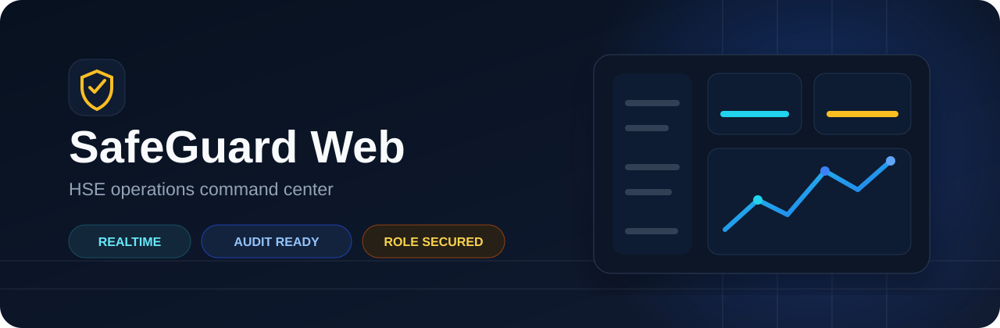
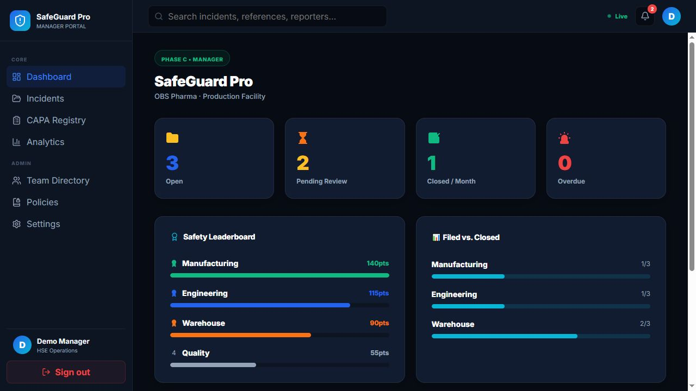
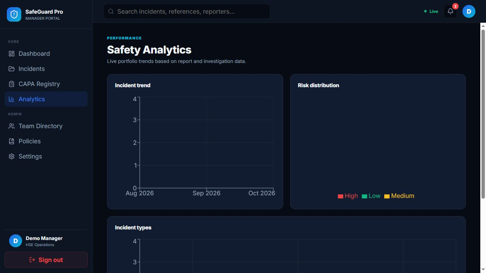
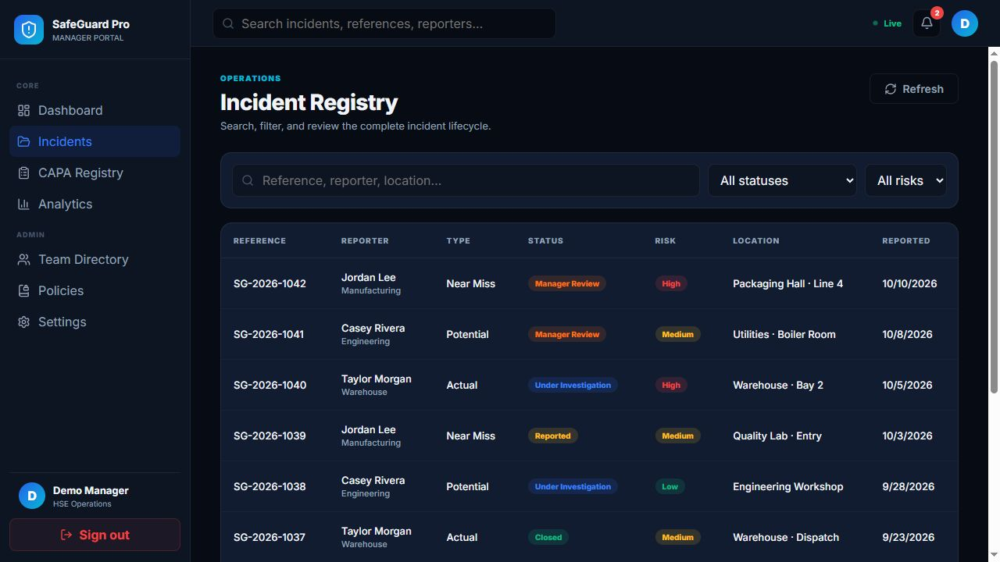
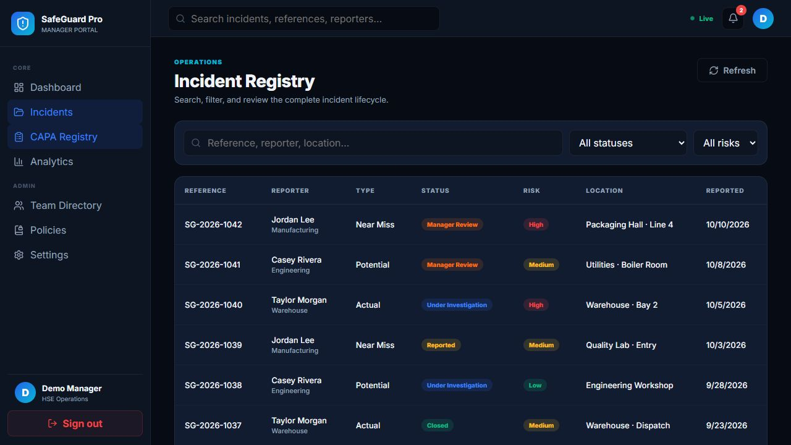
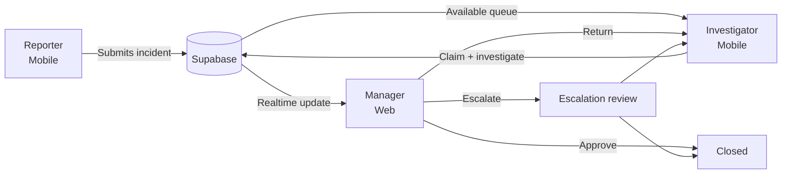

# SafeGuard Web

<p align="center">
  
</p>

<p align="center">
  <a href="https://github.com/Abdullah6482/safeguard-web/actions/workflows/ci.yml"></a>
  
  
  
  <a href="LICENSE"></a>
</p>

SafeGuard Web is the management command center for a full-stack Health, Safety, and Environment (HSE) incident platform. Managers receive field reports in real time, review investigation evidence, govern corrective actions, resolve escalations, and monitor safety performance from one responsive portal.

It works with the companion [SafeGuard Mobile application](https://github.com/Abdullah6482/safeguard-mobile), used by field reporters and investigators.

## Product preview

| Operations dashboard | Safety analytics |
|---|---|
|  |  |

<details>
<summary>More product views</summary>

| Incident registry | CAPA registry |
|---|---|
|  |  |

</details>

## What the product does

| Workspace | Capability |
|---|---|
| Executive dashboard | Live operational KPIs, departmental safety points, closure performance, and pending decisions |
| Incident registry | Search, status/risk filtering, pagination, and complete lifecycle visibility |
| Manager review | Evidence inspection, four-pillar risk review, root-cause findings, CAPA validation, and audit history |
| CAPA registry | Accountable owner, due-date, overdue, and audited status tracking in a Kanban workflow |
| Analytics | Incident trends, risk distribution, and event-type analysis with responsive charts |
| Governance | Manager-only routing, transactional decisions, escalation handling, and optimistic concurrency |

## End-to-end workflow



The workflow is enforced in PostgreSQL—not just in the UI. Privileged state transitions use role-checked RPCs with row locking, expected-version checks, and audit-event creation.

## Engineering highlights

- Supabase Auth plus manager-only protected routes.
- PostgreSQL Row Level Security and restricted direct table mutations.
- Transactional RPCs for manager decisions, CAPA transitions, and escalation resolution.
- Optimistic concurrency protection through `updated_at` checks.
- Realtime incident subscriptions for operational visibility.
- Lazy-loaded routes, error boundaries, responsive navigation, and accessible controls.
- CSV export protection against spreadsheet formula injection.
- 30 automated tests across 17 files, enforced by CI with lint and production builds.

## Architecture

```text
React 19 + React Router + Vite
              │
              ├── Auth context and manager route guard
              ├── Operational pages and reusable UI components
              ├── Realtime incident hook
              └── Analytics and export utilities
                              │
                         Supabase API
                              │
        ┌─────────────────────┼─────────────────────┐
        │                     │                     │
      Auth              PostgreSQL/RLS       Realtime + Storage
                              │
                  Transactional workflow RPCs
```

See [the architecture notes](docs/ARCHITECTURE.md) and [database migrations](supabase/migrations) for implementation details.

## Run locally

Requirements: Node.js 22+ and access to a Supabase project with the SafeGuard schema.

```bash
git clone https://github.com/Abdullah6482/safeguard-web.git
cd safeguard-web
npm ci
cp .env.example .env
npm run dev
```

On Windows PowerShell, use `Copy-Item .env.example .env` instead of `cp`.

Configure only the public browser credentials:

```dotenv
VITE_SUPABASE_URL=https://PROJECT_REF.supabase.co
VITE_SUPABASE_ANON_KEY=sb_publishable_your_key
```

Never place a service-role or `sb_secret_...` key in a Vite environment variable.

Apply migrations in filename order from [`supabase/migrations`](supabase/migrations). The authenticated profile must have the `manager` role.

For a screenshot-safe, read-only portfolio build, set `VITE_DEMO_MODE=true`. This bypasses authentication only for that explicitly configured build and renders synthetic records; never enable it for an operational deployment.

## Quality checks

```bash
npm run check       # ESLint + 30 tests + production build
npm run test        # Vitest only
npm run build       # Optimized production bundle
```

GitHub Actions runs the same release check for pushes and pull requests targeting `master` or `dev`.

## Repository map

```text
src/auth/                 session state and role protection
src/components/           filters, CAPA, evidence, and shared UI
src/hooks/                realtime incident portfolio
src/screens/manager/      dashboard and management workspaces
src/utils/                analytics, audit, export, and validation
supabase/migrations/      database workflow and security migrations
docs/                     architecture and product media
```

## Security note

Frontend builds use only Supabase publishable credentials. Database authorization remains enforced through grants, RLS, and trusted RPCs. The current `incident-photos` bucket retains public-read compatibility for existing URLs; a future privacy migration should use a private bucket and short-lived signed URLs.

See [SECURITY.md](SECURITY.md) for responsible disclosure guidance.

## License

Released under the [MIT License](LICENSE).
